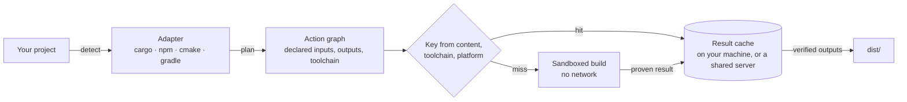

<div align="center">

<picture>
  <source media="(prefers-color-scheme: dark)" srcset="docs/assets/banner-dark.svg">
  
</picture>

### Stop waiting on builds.

**One command builds anything: Rust, Android, JavaScript, Go, Python, Java, .NET, C/C++, Flutter, iOS.**
**Ant remembers every build it has proven, so the rebuild that used to cost you minutes comes back in under a second.**

[](https://github.com/vortemain/ant/actions/workflows/ci.yml)
[](https://github.com/vortemain/ant/actions/workflows/bench-android.yml)
[](rust-toolchain.toml)
[](https://github.com/vortemain/ant/releases/latest)
[](#download)
[](docs/plan.md)

[Download](#download) · [Quick start](#quick-start) · [Benchmarks](#measured-not-promised) · [How it works](#how-it-works) · [Teams & servers](#bring-your-team-and-your-servers) · [Roadmap](#roadmap) · [Docs](#documentation)

</div>

---

```bash
cd my-project
ant build
```

```
ant build · cargo · release · 1 step · 8 parallel
  ✓ workspace  1.6s

Built in 2.0s →
  dist/greeter
```

No config file. Ant detects the project, builds it on every core, and puts the deliverables in `dist/`.

## Measured, not promised

Every number below comes with its raw data and script in this repository. Each one ran on **a single 4-core machine**: no extra hardware and no network. The laptop rows are plain `ant build` on a 2019 Windows laptop; the others are public CI runs. They're single-machine measurements, not general claims.

| Project | Scenario | Native tool | **Ant** | |
|---|---|---:|---:|---|
| **Rust on a laptop**: Ant itself, plain `ant build`, Core i5-8365U, Windows 11 | switch back to a branch you built before | cargo: 12.9–19.1 s | **0.38–0.53 s** | ~30× |
| | nothing changed | cargo: 0.39–0.42 s | **0.14–0.21 s** | ~2.5× |
| **Rust on Linux**: same, plain `ant build`, 4-core CI runner | switch back to a branch you built before | cargo: 2.4–2.6 s | **0.16 s** | ~15× |
| **Android on a laptop**: minimal one-screen app, plain `ant build`, same laptop (hand-run) | one-line edit | Gradle, warm daemon: 6.2–29.5 s | **2.3–4.4 s** | ~2× |
| | nothing changed | Gradle, warm daemon: 5.9–8.6 s | **0.11–0.35 s** | ~20× |
| **Android**: JetNews (Jetpack Compose) | fresh checkout | Gradle, warm daemon + build cache: 4.0–4.6 s | **0.65–0.85 s** | ~5× |
| | nothing changed | Gradle, warm daemon: 1.6–2.2 s | **0.66–0.86 s** | ~2.5× |
| | first build ever | Gradle: 156.9 s | 159.0 s | tie |
| **Rust**: Ant itself (10 crates, 291 MB vendored) | fresh checkout | cargo: 25.2 s | **0.54–0.74 s** | ~40× |
| | first build ever | cargo: 24.3 s | 33.3 s | |

Reports: [Rust on a laptop](docs/benchmarks/2026-11-14-local-windows.md) · [Android](docs/benchmarks/2026-11-13-android.md) · [Rust](docs/benchmarks/2026-11-13-remote-cache.md).
A "fresh checkout" is a new clone or branch folder, or a teammate's copy. Native tools rebuild from scratch there, while Ant reuses the result it already proved. The fresh-checkout numbers come from Ant's cache engine run as a local service (`ant remote run` against `127.0.0.1`). Plain `ant build` already reuses everything this machine built before (the laptop rows); doing the same across clones and for Android is the current phase (P3). Where Ant still loses, for example the one-file edit loop against a warm Gradle daemon, the reports say so.

## Why developers switch to Ant

- **⚡ Your laptop, but fast.** Ant never rebuilds what it has already built. Switching branches, re-cloning, or pulling a teammate's work all come back in under a second, even on an old machine.
- **🎯 One command, every stack.** `cd` into a Rust, Android, npm, or CMake project and type `ant build`. There's no config to write and no flags to learn, and the deliverables land in `dist/`.
- **🔒 Fast and correct.** Ant reuses a result only when it can prove it: the build ran sealed off from the network, with every input fingerprinted and the exact compiler identified. Stale builds and "works on my machine" mysteries go away.
- **📦 Built to ship.** Ant produces what you actually deliver, like binaries and APKs, verified byte for byte.
- **🚀 Grows with you.** Got a teammate, a CI pipeline, or a spare server? Point them at Ant and they get the same instant rebuilds, on infrastructure you own.
- **📏 Proof, not marketing.** Every number on this page links to a public CI run with the raw data, including the cases where Ant doesn't win yet.

## Download

Ant is a single executable with no dependencies. Install it with one command:

```powershell
# Windows (PowerShell)
irm https://raw.githubusercontent.com/vortemain/ant/main/scripts/install/install.ps1 | iex
```

```bash
# macOS and Linux
curl -fsSL https://raw.githubusercontent.com/vortemain/ant/main/scripts/install/install.sh | sh
```

The installer picks the right build for your machine, verifies its SHA-256 checksum, and adds it to your PATH. `ant upgrade` keeps it current.

Or download the file yourself from the [latest release](https://github.com/vortemain/ant/releases/latest):

| System | Download |
|---|---|
| Windows x64 | [ant-x86_64-pc-windows-msvc.exe](https://github.com/vortemain/ant/releases/latest/download/ant-x86_64-pc-windows-msvc.exe) |
| Windows Arm64 | [ant-aarch64-pc-windows-msvc.exe](https://github.com/vortemain/ant/releases/latest/download/ant-aarch64-pc-windows-msvc.exe) |
| macOS Apple Silicon | [ant-aarch64-apple-darwin](https://github.com/vortemain/ant/releases/latest/download/ant-aarch64-apple-darwin) |
| macOS Intel | [ant-x86_64-apple-darwin](https://github.com/vortemain/ant/releases/latest/download/ant-x86_64-apple-darwin) |
| Linux x64 (static) | [ant-x86_64-unknown-linux-musl](https://github.com/vortemain/ant/releases/latest/download/ant-x86_64-unknown-linux-musl) |
| Linux Arm64 (static) | [ant-aarch64-unknown-linux-musl](https://github.com/vortemain/ant/releases/latest/download/ant-aarch64-unknown-linux-musl) |

Checksums are in [SHA256SUMS](https://github.com/vortemain/ant/releases/latest/download/SHA256SUMS). Rename the file to `ant` (`ant.exe` on Windows) and put it on your PATH. To build from source instead (Rust 1.95, pinned in `rust-toolchain.toml`): `cargo install --git https://github.com/vortemain/ant ant-cli`.

## Quick start

Then, in any supported project:

```bash
ant build          # release build, deliverables in dist/
ant build --dev    # debug build
ant init           # optional: write ant.toml so every machine builds the same way
ant dashboard      # your builds, logs, and deliverables in the browser
ant install        # put the Android app on your phone (USB, or scan a QR code)
ant preview        # live preview on your phone and browser; updates on every save
```

See [Getting started](docs/getting-started.md).

## What works today

| Ecosystem | `ant build` delivers | Reuses unchanged results |
|---|---|---|
| Rust / Cargo (incl. workspaces) | binaries | ✅ |
| Android / Gradle | debug APKs; signed release APK + AAB with `--release` | ✅ (warm Gradle daemon kept) |
| JavaScript / TypeScript / npm (Vite, Next, workspaces) | build output folders | ✅ with a lockfile |
| Go | executables | ✅ |
| Python | wheels | |
| Java / Maven | jars | |
| .NET | published app folders | |
| C / C++ / CMake | executables and libraries | |
| Flutter (web) | `build/web` | |
| iOS / Xcode | `.app` bundles (unsigned) | |
| Docker | images, or an image tarball | |
| Tauri, Electron | desktop app bundles (not yet verified in CI) | |

Real builds of the Maven, Python, .NET, Docker, Flutter and iOS examples in [`examples/`](examples/) run in CI on Linux, Windows and macOS. Ship with `ant publish android` (Google Play), share with `ant install`/`ant preview`, and watch everything in `ant dashboard`.

| Platform | Status |
|---|---|
| Windows | ✅ builds, restricted-token sandbox, job objects, memory caps, keys sealed with DPAPI |
| Linux | ✅ builds, bubblewrap sandbox with no network, keys in Secret Service |
| macOS | ✅ builds (incl. iOS), keys in the Keychain |

## How it works



1. **Adapters** read your build system (Cargo, npm, CMake, Gradle) and produce a plan: each action's command, declared inputs, outputs, and toolchain.
2. **Keys** come from content digests, the toolchain identity, and the execution platform, never from paths or timestamps.
3. **Builds run in a sandbox** with no network, on your machine, or on a worker if you have one. Only sandboxed builds can write to the cache, and every blob is re-hashed on read and write.
4. **Results** come back verified and land in your workspace and `dist/`.

## Bring your team and your servers

Ant runs entirely on your own machine. When you're ready, put your own server to work with one command (any Linux VPS with systemd, reached over SSH):

```bash
ant server deploy root@your-server --toolchain rust --workers 3
ant build --on your-server      # build there (same OS as your laptop), outputs come back to dist/
ant server ui your-server       # watch it in the dashboard: workers, jobs, live output
ant server status your-server
```

The server's coordinator listens only on the server itself; Ant reaches it through SSH, with keys, never passwords. Teams can run one behind HTTPS and sign in with their identity provider (`ant login https://builds.example.com --sso`). See [operations](docs/remote/operations.md) and [protocol v1](docs/remote/protocol-v1.md).

## Roadmap

| Phase | Goal | State |
|---|---|---|
| P1 Front door | `ant build`, `ant init`, zero config | ✅ shipped |
| P2 Speed engine | proven result cache, measured on Rust and Android | ✅ shipped |
| P3 Local-first speed | reuse on a laptop with no server, fast edit loops | ✅ shipped |
| P4 Android | Gradle builds, signing, install over USB or QR | ✅ shipped |
| P5 iOS | Xcode builds; signing and App Store upload | 🚧 unsigned builds shipped |
| P6 Everything else | Go, Python, Java, .NET, Flutter, Docker, desktop apps | ✅ shipped |
| P7 Dashboard | builds, live logs, deliverables, QR installs | ✅ shipped |
| P8 Optional servers | `ant server deploy`, offload, several workers, team servers | ✅ shipped |
| P9 Ship | Google Play upload, live preview, single sign-on | ✅ shipped; App Store next |

The full plan, acceptance criteria, and decision log are in [`docs/plan.md`](docs/plan.md). The product vision is in [`docs/vision.md`](docs/vision.md).

## Documentation

| | |
|---|---|
| [Getting started](docs/getting-started.md) | `ant build` and `ant init` |
| [Build adapters](docs/cli/adapters.md) | every ecosystem: what's declared and the honest limits |
| [Cache keys](docs/cli/cache-and-keys.md) | what goes into a key and why results are reused |
| [Teams & servers](docs/remote/operations.md) | `ant server deploy`, workers, tokens, single sign-on, the server UI |
| [Architecture](docs/architecture.md) | crates, contracts, trust boundaries |
| [Security model](docs/security/threat-model.md) | what's protected, from whom, and what isn't yet |
| [Benchmarks](docs/benchmarks/) | methodology and every recorded run |

## Contributing

```bash
./scripts/check.sh      # Linux/macOS: rustfmt, clippy -D warnings, all tests
./scripts/check.ps1     # Windows
```

All three are hard gates, and CI runs them on Linux and Windows for every push. Read [`AGENTS.md`](AGENTS.md) before changing a contract. It explains how work is planned, logged, and handed off.

<div align="center">
<sub>Built in Rust · Runs on the machine you have · Every claim backed by a CI run</sub>
</div>
