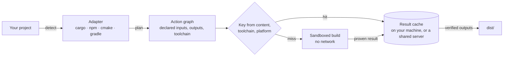

<div align="center">

<picture>
  <source media="(prefers-color-scheme: dark)" srcset="docs/assets/banner-dark.svg">
  
</picture>

### Stop waiting on builds.

**One command builds anything: Rust, Android, JavaScript, C/C++.**
**Ant remembers every build it has proven, so the rebuild that used to cost you minutes comes back in under a second.**

[](https://github.com/vortemain/ant/actions/workflows/ci.yml)
[](https://github.com/vortemain/ant/actions/workflows/bench-android.yml)
[](rust-toolchain.toml)
[](#what-works-today)
[](docs/plan.md)

[Quick start](#quick-start) · [Benchmarks](#measured-not-promised) · [How it works](#how-it-works) · [Teams & servers](#bring-your-team-and-your-servers) · [Roadmap](#roadmap) · [Docs](#documentation)

</div>

---

```bash
cd my-project
ant build
```

```
ant build · cargo · release · 1 step · 8 parallel
  ✓ workspace  1.6s

Built in 2.0s →
  dist/greeter
```

No config file. Ant detects the project, builds it on every core, and puts the deliverables in `dist/`.

## Measured, not promised

Every number below comes from a public CI run, with its raw data in this repository. Each one ran on **a single 4-core machine**: no extra hardware and no network. They're single-machine measurements, not general claims.

| Project | Scenario | Native tool | **Ant** | |
|---|---|---:|---:|---|
| **Android**: JetNews (Jetpack Compose) | fresh checkout | Gradle, warm daemon + build cache: 4.0–4.6 s | **0.65–0.85 s** | ~5× |
| | nothing changed | Gradle, warm daemon: 1.6–2.2 s | **0.66–0.86 s** | ~2.5× |
| | first build ever | Gradle: 156.9 s | 159.0 s | tie |
| **Rust**: Ant itself (10 crates, 291 MB vendored) | fresh checkout | cargo: 25.2 s | **0.54–0.74 s** | ~40× |
| | first build ever | cargo: 24.3 s | 33.3 s | |

Reports: [Android](docs/benchmarks/2026-11-13-android.md) · [Rust](docs/benchmarks/2026-11-13-remote-cache.md).
A "fresh checkout" is a new clone or branch folder, or a teammate's copy. Native tools rebuild from scratch there, while Ant reuses the result it already proved. Today these numbers come from Ant's cache engine run as a local service (`ant remote run` against `127.0.0.1`). Making plain `ant build` do this automatically is the current phase (P3). Where Ant still loses, for example the one-file edit loop against a warm Gradle daemon, the reports say so.

## Why developers switch to Ant

- **⚡ Your laptop, but fast.** Ant never rebuilds what it has already built. Switching branches, re-cloning, or pulling a teammate's work all come back in under a second, even on an old machine.
- **🎯 One command, every stack.** `cd` into a Rust, Android, npm, or CMake project and type `ant build`. There's no config to write and no flags to learn, and the deliverables land in `dist/`.
- **🔒 Fast and correct.** Ant reuses a result only when it can prove it: the build ran sealed off from the network, with every input fingerprinted and the exact compiler identified. Stale builds and "works on my machine" mysteries go away.
- **📦 Built to ship.** Ant produces what you actually deliver, like binaries and APKs, verified byte for byte.
- **🚀 Grows with you.** Got a teammate, a CI pipeline, or a spare server? Point them at Ant and they get the same instant rebuilds, on infrastructure you own.
- **📏 Proof, not marketing.** Every number on this page links to a public CI run with the raw data, including the cases where Ant doesn't win yet.

## Quick start

Ant is in early preview. Build it from source (Rust 1.95, pinned in `rust-toolchain.toml`):

```bash
git clone https://github.com/vortemain/ant.git
cd ant
cargo install --path crates/ant-cli
```

Then, in any supported project:

```bash
ant build          # release build, deliverables in dist/
ant build --dev    # debug build
ant init           # optional: write ant.toml so every machine builds the same way
```

See [Getting started](docs/getting-started.md).

## What works today

| Ecosystem | `ant build` | Proven result reuse (cache engine) |
|---|---|---|
| Rust / Cargo (incl. workspaces) | ✅ binaries into `dist/`; reuses its own earlier builds | ✅ measured, with vendored dependencies |
| JavaScript / TypeScript / npm (incl. workspaces) | ✅ | not yet (`node_modules` is undeclared) |
| C / C++ / CMake | ✅ | not yet |
| Android / Gradle | via `ant adapt` (P3 brings it to `ant build`) | ✅ measured on JetNews, plus Gradle's own task cache |
| iOS, web bundlers, desktop installers, containers | roadmap | roadmap |

| Platform | Status |
|---|---|
| Linux | bubblewrap sandbox with no network; proven results are cached |
| Windows | restricted-token sandbox, job objects, memory caps, network-isolated account |
| macOS | not yet (needed for iOS) |

## How it works



1. **Adapters** read your build system (Cargo, npm, CMake, Gradle) and produce a plan: each action's command, declared inputs, outputs, and toolchain.
2. **Keys** come from content digests, the toolchain identity, and the execution platform, never from paths or timestamps.
3. **Builds run in a sandbox** with no network, on your machine, or on a worker if you have one. Only sandboxed builds can write to the cache, and every blob is re-hashed on read and write.
4. **Results** come back verified and land in your workspace and `dist/`.

## Bring your team and your servers

Ant runs entirely on your own machine. When you're ready, it scales out: send builds to a VPS or a spare machine, and share every proven result with your team and CI:

```bash
# On your server
ant coordinator --data-dir /var/lib/ant --client-token-file client.token --worker-token-file worker.token

# On each build machine (Linux)
ant worker --coordinator https://builds.example.com --token-file worker.token --work-dir /var/tmp/ant --sandbox

# From your laptop or CI
ant adapt --out plan.json
ant remote run --coordinator https://builds.example.com --token-file client.token --plan plan.json
```

The coordinator also serves a read-only dashboard at `/ui` (viewer token). See [operations](docs/remote/operations.md) and [protocol v1](docs/remote/protocol-v1.md). A one-command `ant server deploy` is planned for P8.

## Roadmap

| Phase | Goal | State |
|---|---|---|
| P1 Front door | `ant build`, `ant init`, zero config | ✅ shipped |
| P2 Speed engine | proven result cache, measured on Rust and Android | ✅ shipped |
| P3 Local-first speed | all of that inside plain `ant build` on a laptop, with no server: cache on by default, fast change detection, a fast edit loop | 🚧 next |
| P4 Android | Gradle builds, signing, install-by-QR | 🚧 builds and caches APKs, Gradle task cache shipped |
| P5 iOS | Xcode builds on your Mac workers | planned |
| P6 Everything else | web, desktop, containers, more languages | planned |
| P7 Dashboard | Expo-quality UI: builds, logs, artifacts, QR installs | seeded (`/ui`) |
| P8 Optional servers | `ant server deploy`, offload to your VPS, team-wide cache | engine exists, one-command setup planned |
| P9 Ship | store submission, live preview | planned |

The full plan, acceptance criteria, and decision log are in [`docs/plan.md`](docs/plan.md). The product vision is in [`docs/vision.md`](docs/vision.md).

## Documentation

| | |
|---|---|
| [Getting started](docs/getting-started.md) | `ant build` and `ant init` |
| [Build adapters](docs/cli/adapters.md) | Cargo, npm, CMake, Gradle: what's declared and the honest limits |
| [Cache keys](docs/cli/cache-and-keys.md) | what goes into a key and why results are reused |
| [Teams & servers](docs/remote/operations.md) | coordinator, workers, tokens, dashboard |
| [Architecture](docs/architecture.md) | crates, contracts, trust boundaries |
| [Security model](docs/security/threat-model.md) | what's protected, from whom, and what isn't yet |
| [Benchmarks](docs/benchmarks/) | methodology and every recorded run |

## Contributing

```bash
./scripts/check.sh      # Linux/macOS: rustfmt, clippy -D warnings, all tests
./scripts/check.ps1     # Windows
```

All three are hard gates, and CI runs them on Linux and Windows for every push. Read [`AGENTS.md`](AGENTS.md) before changing a contract. It explains how work is planned, logged, and handed off.

<div align="center">
<sub>Built in Rust · Runs on the machine you have · Every claim backed by a CI run</sub>
</div>
