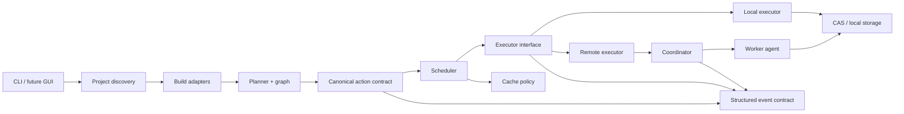
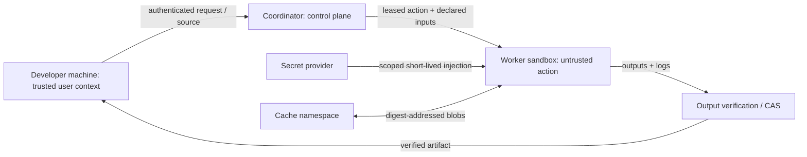

# Architecture baseline

**Status:** Initial design, subject to revision as research and implementation evidence accumulates. This describes intended boundaries, not implemented production capabilities.

## Design constraints

- One action meaning across local and remote execution.
- Keep source acquisition, project adapters, planning, scheduling, execution, caching, and control plane behind explicit interfaces.
- Cache only actions whose complete semantic inputs are represented and whose outputs are verified.
- Treat submitted commands, project files, adapters, and artifacts as untrusted at worker boundaries.
- Work offline locally when required tools and dependencies are already present.

## Components and dependency direction

Dependency rule: domain contracts sit below adapters, planners, schedulers, and transports. The core domain must not depend on UI, cloud vendor SDKs, a database, or any specific build system. Remote protocol mappings translate to/from canonical contracts and must not leak protocol-specific types into core APIs.

## Adapter contract

Adapters turn a real build-system project into a plan. The contract (`build-adapter`, decision D-010) is an in-process trait: `detect` performs a non-destructive compatibility check, `generate` produces the canonical `build-graph::PlanFile` — the same versioned document `ant run --plan` loads — and re-validates it through the build graph, so adapter output is never a second, weaker action model. Honesty rules: adapters declare only what they can honestly cover; toolchain identity is captured from the real toolchain; unknown artifact layouts are omitted rather than guessed; under-declared inputs force `cache_policy: never`. One deliberate exception to inspection-only generation: an adapter may prepare its staging directory (`.ant/tmp` inside the project) so generated actions can point `TMP`/`TEMP` (plus `TMPDIR` on non-Windows, unverified there) at a workspace-relative path — toolchain scratch writes (the MSVC linker's response files, rustc temporaries) otherwise land in the system temp directory and are blocked by `ant run --sandbox`; the staging directory is idempotently created, is not a declared input or output, and is safe to delete at any time (T3.3). Two adapters are landed: **Cargo** (`ant adapt --adapter cargo`; per-member `cargo build` actions, mapped bin/lib outputs, cargo toolchain identity) and **npm** (`ant adapt --adapter npm`; one `npm run build` action from `package.json`, no guessed outputs, `node` toolchain identity, `cmd /C npm run build` on Windows because `npm` is a batch shim) — each chosen on the feasibility ground that real adapt → run → artifact verification is possible in the development environment. An external adapter protocol can be added later without breaking the contract because adapters emit the plan-file format the run path already loads.

## Initial crate plan

Create crates only when a stable boundary and independent responsibility justify them. Current implementation slices: `build-action` owns action identity and declared I/O; `build-graph` owns deterministic DAG validation and ordering plus the canonical plan-file envelope (`PlanFile`); `build-digest` owns content digesting, the local environment fingerprint and runtime environment allowlist, and action-key candidates; `build-adapter` owns the adapter contract, the Cargo adapter, and the npm adapter (with shared PATH-resolution/version helpers); `local-executor` runs one action directly (split into `prepare`, which validates and digests declared inputs before any process starts, and `execute_prepared`), and on Windows also `execute_sandboxed_cancellable`/`execute_sandboxed_prepared` which run the action inside the `ant-sandbox-win` restricted-token filesystem sandbox (deliberately does not inherit the workspace `unsafe_code = "forbid"` lint, per D-008); `build-cache` owns the local content-addressed store; `build-events` owns the structured event schema; `ant-cli` exposes the `ant` CLI. Avoid creating the full list in the master spec as empty crates.

## Action contract (v0 proposal)

An action consists of:
- Stable schema/versioned identity, argv-style command (no implicit shell), working directory.
- Declared file/tree inputs and outputs, represented by normalized workspace-relative paths.
- Explicit non-secret environment values; secrets are references injected by a trusted executor and excluded from ordinary serialization and cache identity.
- Toolchain/runtime identity, target platform, and relevant execution properties.
- Resource/time limits and network policy, each explicit or marked unspecified.
- Cache policy: `Never` by default; `Eligible` only after inputs, toolchain, environment, platform, and determinism assumptions are declared. Eligibility is not proof of hermeticity.

Validation must reject malformed paths, duplicate/overlapping output declarations where ambiguous, invalid identifiers, and invalid resource bounds. Canonical serialization and digest format remain open pending cross-platform/path research. Never hash secret values into globally observable keys.

## Graph and scheduling semantics

The graph is a DAG of action identities and dependency edges. Cycles are planning errors. The initial `build-graph` API validates action contracts, duplicate IDs, unknown/self dependencies, and cycles. It orders currently ready actions deterministically by action ID. It does not execute tasks, track completion/failure, or mutate graphs dynamically. The plan CLI executes the order with bounded parallelism (`--jobs`, default 1): dependencies complete successfully before dependents start, and the first failure, timeout, or cooperative cancellation stops new starts while running actions terminate; unstarted actions are reported as skipped. Among concurrently ready actions, start order is not deterministic above one job. Cancellation converts Ctrl+C into a cooperative token (CLI-level signal handling) and kills the direct child; on Windows the child's process tree runs in a kill-on-close job object so descendants are also terminated, while other platforms still guarantee only direct-child cleanup. Parallel admission is resource-weighted: `--jobs` is a CPU-slot capacity, `--memory-mb` an optional memory budget, and each action's optional `resources` request (`cpu`, `memory_mb`) is reserved under one lock with strict FIFO order over the ready queue (no backfill past a head that does not fit, so heavy actions cannot starve) and clamped to the total capacity so no request can deadlock a run. Requests are admission weights, not enforced runtime limits, and are excluded from the action key (D-011). With `--keep-going`, failures block only their transitive dependents and workers stop when nothing is ready or running. With `--enforce-memory` (Windows), a declared `memory_mb` is enforced as a job-wide committed-memory cap set while the child is still suspended (FFI in `ant-sandbox-win::job`, fail closed), and job-tracked runs report measured peak memory. Structured cancellation events, peak memory in the event stream, CPU-time limits, and non-Windows enforcement remain open.

## Execution interface

Executor capabilities include supported platform/toolchains, resource headroom, sandbox/network features, and protocol version. Execution returns a structured result with exit status, output digests, logs/diagnostics references, timestamps, and failure category. Cancellation, timeout, worker loss, and partial output cleanup have explicit outcomes. Local executor is first; remote transport follows once these semantics are stable.

## Cache key boundary

Candidate key material currently covers action schema version, command/arguments, working directory, timeout, sorted declared environment, declared input paths/content digests, outputs, toolchain identity, local OS/architecture, the captured OS platform version, canonical workspace path, and the inherited allowlisted process environment (the `local_runtime_environment` values the executor passes through after clearing the child environment; on Windows this includes the well-known machine root variables `SystemDrive`/`ProgramFiles`/`ProgramFiles(x86)`/`ProgramW6432`, added in T3.2 because toolchains consult them when locating their own linkers at spawn time). Input digests in the default run mode include filesystem metadata (file size and last-modification time), so timestamp-only input changes produce a different key; this is proven by an end-to-end test. Declared outputs are digested by content only so a cache can verify restored outputs without reproducing timestamps. The workspace path is hashed into the key itself, so outputs embedding the absolute workspace path are covered by the key rather than by a separate blocker. The CLI prints a candidate key and explicit cacheability blockers after successful execution; `ant plan explain` produces the same facts pre-run for inspection.

Blockers are capability-driven: an `ExecutionFingerprint` carries `ExecutorCapabilities { sandboxed, network_isolation, metadata_fingerprinting }` that the executor must truthfully declare. The direct local executor digests inputs with metadata and captures the platform version, so `filesystem-metadata-not-fingerprintable` and `platform-version-unspecified` no longer appear. The Windows sandboxed executor (`execute_sandboxed_cancellable` behind `ant run --sandbox`) additionally declares `sandboxed: true`, so `local-executor-unsandboxed` disappears under `--sandbox` — but `network-isolation-unavailable` remains: restricted tokens cannot prevent network access for same-user code. The intended Windows approach is realized in `docs/sandbox/windows-design.md` (and the `ant-sandbox-win` crate); network-enforcement options — including the proven dedicated-sandbox-user + elevated-setup mechanism and why per-run non-elevated WFP is impossible — are documented in `docs/sandbox/network-isolation.md` (D-009). There is no CLI override. The `build-cache` CAS library (blobs, per-key manifests, atomic writes, integrity-checked restore) is wired into `ant run --plan --cache-dir` behind the blocker gate: a key is stored or looked up only when its candidate reported no blockers, so nothing is reused until an executor truthfully reports sandboxing **and** network isolation (D-003 addendum); cache failures degrade to misses or warnings, never to trusting unverified content. `ant plan explain --cache-dir` still works as presence-only diagnostics. Exclude secret values; any secret-dependent output is non-cacheable by default. Tenant namespace and remote authentication rules remain open.

## Event contract

Every invocation can emit a structured event stream (`--events PATH`), one JSON object per line, schema version 2, owned by the `build-events` crate. Events carry measured facts only: `run_started` (execution mode and parallelism), `action_started`, `action_finished` (status — `succeeded`, `failed`, `cancelled`, `timed_out`, or `reused` for an action satisfied from a verified cache entry — exit code, observed input/output digests, action-key candidate and cacheability, error text), `action_skipped`, and `run_finished` (outcome with executed/skipped counts; reused actions count as executed because the plan advanced through them). A per-invocation `run_id` correlates all events of one run; timestamps are wall-clock facts, not estimates. Events never contain secret values. The console status lines remain the human-readable mirror of the same transitions; the JSON stream is the machine-readable contract intended for future GUI, coordinator, and observability consumers. Event schema evolution must be additive and versioned through `EVENT_SCHEMA_VERSION` (v2 added the `reused` status).

## Trust boundaries and threat sketch

Threats: malicious repository commands; path traversal and symlink escapes; cache poisoning; secret exfiltration via network/logs/artifacts; cross-tenant leakage; worker compromise; dependency substitution; denial of service; compromised coordinator; artifact tampering. Initial mitigations: path validation, least privilege, bounded resources, restricted network by default where feasible, short-lived scoped secrets, output digest verification, authenticated transport, tenant-scoped metadata, auditable policy decisions, and isolation appropriate to host OS. These are design goals; a concrete threat model and sandbox choice remain Stage 0 deliverables.

## Execution modes

- Local: CLI → discovery/adapter → plan → scheduler → local executor → local CAS.
- VPS: client uploads a content-addressed source snapshot or requests configured Git acquisition; coordinator queues; worker leases compatible action; verified outputs/logs return to client.
- Hybrid: planner estimates transfer, queue, startup, cache locality, runtime, and return cost; policy can force local/remote; placement reason is observable.
- Managed: same coordinator/worker contracts with tenant isolation, quotas, metering, regional placement, and operational control plane.
- Enterprise: same contracts deployed single/multi tenant with identity, RBAC, audit, retention, policy, private dependencies, and recovery controls.

These modes are target architecture only. Begin with local.

## Key open decisions

See `docs/plan.md` and `docs/research.md`: sandbox implementation by OS; action canonical encoding; SQLite and Postgres boundary; gRPC vs HTTP APIs; REAPI interoperability scope; supported first adapter; cache namespace and trust policy; license and trademark strategy.

